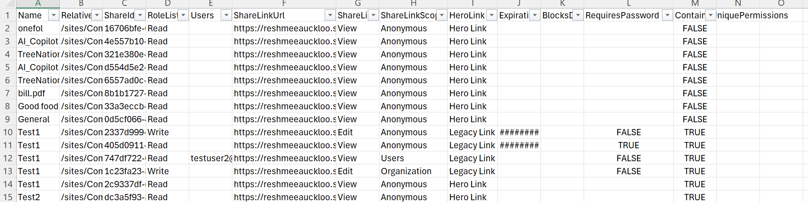

# Hero links inventory

## Summary

Microsoft's third-generation sharing experience, Hero Links, introduces a simpler way to manage file-sharing access, with a stronger emphasis on secure defaults and granular permissions. The main administrative point is that Hero Links and legacy sharing links do not follow the same policy behavior. This script is an attempt to provide some visibility on those links. The script may change if Microsoft make better APIs available to retrieve hero links information. From my observation the link token for a hero link starts with a 'c' and using this to differentiate a hero link from a legacy sharing link. 



## Script

The script below enumerates file and folder sharing links and then checks whether the target item has unique permissions. That makes it easier to identify where permission inheritance has been broken. 

# [PnP PowerShell](#tab/pnpps)

```PowerShell
param(
    [Parameter(Mandatory=$true)]
    [string]$SiteUrl
)
function Get-ShareLinkToken {
    param(
        [string]$ShareLinkUrl
    )

    if ([string]::IsNullOrWhiteSpace($ShareLinkUrl)) {
        return $null
    }

    $uri = [System.Uri]$ShareLinkUrl

    # Folder-style links usually carry the token in the "share" query parameter
    $queryParams = [System.Web.HttpUtility]::ParseQueryString($uri.Query)
    $shareToken = $queryParams["share"]

    if (-not [string]::IsNullOrWhiteSpace($shareToken)) {
        return [System.Uri]::UnescapeDataString($shareToken)
    }

    # File-style links usually store the token as the last path segment
    $lastSegment = $uri.Segments[-1].TrimEnd('/')

    if (-not [string]::IsNullOrWhiteSpace($lastSegment)) {
        return [System.Uri]::UnescapeDataString($lastSegment)
    }

    return $null
}

function Get-ListItems_WithUniquePermissions{
    param(
        [Parameter(Mandatory)]
        [Microsoft.SharePoint.Client.List]$List
    )
    $selectFields = "ID,HasUniqueRoleAssignments,FileRef,FileLeafRef,FileSystemObjectType"
   
    $Url = $siteUrl + '/_api/web/lists/getbytitle(''' + $($list.Title) + ''')/items?$select=' + $($selectFields)
    $nextLink = $Url
    $listItems = @()
    $Stoploop =$true
    while($nextLink){  
        do{
        try {
            $response = invoke-pnpsprestmethod -Url $nextLink -Method Get
            $Stoploop =$true
    
        }
        catch {
            write-host "An error occured: $_  : Retrying" -ForegroundColor Red
            $Stoploop =$true
            Start-Sleep -Seconds 30
        }
    }
    While ($Stoploop -eq $false)
    
        $listItems += $response.value | where-object{$_.HasUniqueRoleAssignments -eq $true}
        if($response.'odata.nextlink'){
            $nextLink = $response.'odata.nextlink'
        }    else{
            $nextLink = $null
        }
    }

    return $listItems
}

connect-PnPOnline -Url $siteUrl 
$dateTime = (Get-Date).toString("dd-MM-yyyy-hh-ss")
$invocation = (Get-Variable MyInvocation).Value
$directorypath = Split-Path $invocation.MyCommand.Path
$fileName = "SharedLinks-PnP" + $dateTime + ".csv"
$ReportOutput = $directorypath + "\Logs\"+ $fileName
$global:Results = @();

$ll = Get-PnPList -Includes BaseType, Hidden, Title,HasUniqueRoleAssignments,RootFolder | Where-Object {$_.Hidden -eq $False -and $_.Title -notin $ExcludedLists } #$_.BaseType -eq "DocumentLibrary" 
  Write-Host "Number of lists $($ll.Count)";

  foreach($list in $ll)
  {
    $listUrl = $list.RootFolder.ServerRelativeUrl;       
    $ListItems_withUniquePermissions = Get-ListItems_WithUniquePermissions -List $list

    $links = Get-PnPListItem -List $list.Title | Get-PnPFileSharingLink

$Folders= Get-PnPListItem -List $list.Title -Fields "FileRef", "FileLeafRef", "FileSystemObjectType" | Where-Object { $_.FileSystemObjectType -eq "Folder" }

$folderLinks = $folders | ForEach-Object { 
    Get-PnPFolderSharingLink -Folder $_['FileRef'] -ErrorAction SilentlyContinue 
}

foreach($folderLink in $folderLinks)
{
    if ($folderLink -eq $null) {
        continue
    }

     # Check if ShareId already exists in global results
    if ($global:Results | Where-Object { $_.ShareId -eq $folderLink.Id }) {
        Write-Host "Skipping duplicate ShareId: $($folderLink.Id)" -ForegroundColor Yellow
        continue
    }
  
$isUnique = $false
   $uniqueItem = $listItems_withUniquePermissions | Where-Object { $_.FileRef -eq $folderLink.Parent.ServerRelativeUrl }
   if ($uniqueItem) {
    $isUnique = $true
   }
   else {
       $isUnique = $false
   }
   $LinkToken = Get-ShareLinkToken -ShareLinkUrl $folderLink.Link.WebUrl
    $result = New-Object PSObject -property $([ordered]@{
            Name = $folderLink.Parent.Name          
            RelativeURL = $folderLink.Parent.ServerRelativeUrl
            ShareId = $folderLink.Id
            RoleList = $folderLink.Roles -join "|"
            Users = $folderLink.GrantedToIdentitiesV2.User.Email -join "|"
            ShareLinkUrl  = $folderLink.Link.WebUrl
            ShareLinkType  = $folderLink.Link.Type
            ShareLinkScope  = $folderLink.Link.Scope
            HeroLink    = if ($LinkToken -and $LinkToken.StartsWith('c', [System.StringComparison]::OrdinalIgnoreCase)) { 'Hero Link' } else { 'Legacy Link' }
            Expiration = $folderLink.ExpirationDateTime
            BlocksDownload = $folderLink.Link.PreventsDowload
            RequiresPassword = $folderLink.HasPassword
            ContainsUniquePermissions = $isUnique
                        
        })
        $global:Results +=$result;
}
 

foreach($ShareLink in $links)
{
    # Skip if ShareLink is null
    if ($ShareLink -eq $null) {
        continue
    }

    # Check if ShareId already exists in global results
    if ($global:Results | Where-Object { $_.ShareId -eq $ShareLink.Id }) {
        Write-Host "Skipping duplicate ShareId: $($ShareLink.Id)" -ForegroundColor Yellow
        continue
    }
    $uniqueItem = $listItems_withUniquePermissions | Where-Object { $_.FileRef -eq $ShareLink.Parent.ServerRelativeUrl }
    $isUnique = $false
 if ($uniqueItem) {
    $isUnique = $true
   }
   else {
       $isUnique = $false
   }
   $LinkToken = Get-ShareLinkToken -ShareLinkUrl $ShareLink.Link.WebUrl
    $result = New-Object PSObject -property $([ordered]@{
            Name = $ShareLink.Parent.Name          
            RelativeURL = $ShareLink.Parent.ServerRelativeUrl
            ShareId = $ShareLink.Id
            RoleList = $ShareLink.Roles -join "|"
            Users = $ShareLink.GrantedToIdentitiesV2.User.Email -join "|"
            ShareLinkUrl  = $ShareLink.Link.WebUrl
            ShareLinkType  = $ShareLink.Link.Type
            ShareLinkScope  = $ShareLink.Link.Scope
            HeroLink    = if ($LinkToken -and $LinkToken.StartsWith('c', [System.StringComparison]::OrdinalIgnoreCase)) { 'Hero Link' } else { 'Legacy Link' }
            Expiration = $ShareLink.ExpirationDateTime
            BlocksDownload = $ShareLink.Link.PreventsDowload
            RequiresPassword = $ShareLink.HasPassword
            ContainsUniquePermissions = $isUnique
                        
        })
        $global:Results +=$result;
    }
  }
 $global:Results | Export-CSV $ReportOutput -NoTypeInformation
  #Export-CSV $ReportOutput -NoTypeInformation
Write-host -f Green "Sharing Links Report Generated Successfully!"
```

[!INCLUDE [More about PnP PowerShell](../../docfx/includes/MORE-PNPPS.md)]

***

## Source Credit

Sample first appeared on [SharePoint Sharing/Hero Link inventory](https://reshmeeauckloo.com/posts/sharepoint-herolink-inventory-powershell/)

Please note that the ShareLinkScope of the unchanged hero link is shown as **Anonymous** which may indicate either 'Anyone with the link' or 'Only people added to the file have access' type. 


## Contributors

| Author(s) |
|-----------|
| [Reshmee Auckloo](https://github.com/reshmee011) |


[!INCLUDE [DISCLAIMER](../../docfx/includes/DISCLAIMER.md)]

